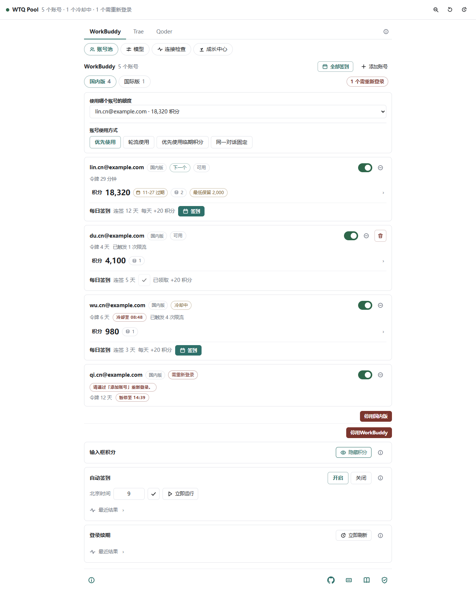

<p align="center">
  <picture>
    <source media="(prefers-color-scheme: dark)" srcset="https://github.com/chengzhi-c/dsh-wtq-pool/raw/main/docs/logo-dark.png">
    <source media="(prefers-color-scheme: light)" srcset="https://github.com/chengzhi-c/dsh-wtq-pool/raw/main/docs/logo.png">
    
  </picture>
</p>

<h1 align="center">WTQ Pool</h1>

<p align="center"><sub>DeepSeek Harness edition · <a href="https://github.com/chengzhi-c/pi-desktop-wtq-pool">PI-Desktop edition</a></sub></p>

<p align="center"><b>Use local WorkBuddy, Trae and Qoder sign-ins in DeepSeek Harness, with account failover based on each sign-in's state.</b></p>

<p align="center">
  <b>English</b> | <a href="README.md">简体中文</a>
</p>

<p align="center">
  <a href="#install">Install</a> ·
  <a href="#usage">Usage</a> ·
  <a href="#features">Features</a> ·
  <a href="#settings">Settings</a> ·
  <a href="CHANGELOG.md">Changelog</a> ·
  <a href="https://github.com/chengzhi-c/dsh-wtq-pool/issues">Issues</a>
</p>

<p align="center">
  <a href="https://www.npmjs.com/package/dsh-wtq-pool"></a>
  <a href="LICENSE"></a>
</p>

> This project is for learning use only. Unofficial clients may trigger account restrictions. Review the risks and the relevant service terms before use.

Providers are registered separately by vendor and region. When an account is rate-limited, out of credits or signed out, requests fail over according to that source's rules.

## Install

Supports DeepSeek Harness `0.2.0` and the `0.2.2` series, including prereleases allowed by `engines.dsh`. Requires Node `^22.19.0 || >=24.0.0`, as well as the Node version required by the host.

### Desktop app

On the **Plugins** page, select **Add plugin** → **Install third-party plugin**, enter `dsh-wtq-pool` and install, then enable the plugin.

### CLI

Requires the DSH CLI (`@deepseek-ai/dsh`). The CLI manages non-desktop profiles such as `web` and `tui`; the `desktop` profile is reserved by the desktop app, so install there through its plugin page.

```powershell
dsh plugin --profile web add dsh-wtq-pool
```

`web` is the DSH profile; replace it with the profile you use. Open **dsh-wtq-pool** on the **Plugins** page. After upgrading from 1.1.x to 1.2.0, provider IDs changed to `wtqpool-*`; select your models again.

## Usage

Sign in to WorkBuddy, Trae or Qoder, then select **Detect accounts again**. WorkBuddy supports multiple sign-ins; domestic Trae reads Trae CN and TRAE SOLO CN separately. Each Qoder installation and the international WorkBuddy edition retain one sign-in, so switching accounts replaces it.

WorkBuddy 5.6+ `$wbEncrypted` sign-ins need a decryption key from the local WorkBuddy installation. On Windows, only signed installations with a supported key on a fixed local drive are used; decryption is skipped when the host runs elevated. On macOS, the local app is run to read the key without signature verification; root processes on macOS and Linux also skip decryption. Use a trusted installation.

### Add an account

Add one through the official sign-in page in the panel, or import an `.info` file containing `{auth, account}`. Run this from a source checkout:

```powershell
$dshHome = if ($env:DSH_HOME) { $env:DSH_HOME } else { Join-Path $HOME ".dsh" }
$pluginData = Join-Path $dshHome "dsh-wtq-pool"
$accountFile = Read-Host "Sign-in file path"
node .\tools\import-signins.cjs --data $pluginData --from $accountFile
```

Optional arguments: `--region cn|global|all`, `--dry-run`, `--force`.

Files in `signins/` contain usable access and refresh tokens; protect them like account passwords. Plugin-owned sign-ins can be deleted after a second confirmation; the desktop app's active sign-in cannot be deleted from the panel.

### Panel

**Account pool** manages sign-ins and account status. **Models** controls published models and display options; **Connection check** reports gateways, catalogues, addresses and host registration; **Growth centre** manages WorkBuddy rewards.

Automatic check-in is off by default, defaults to 09:00 Beijing time and can be changed in the panel; check-in and **Run now** may claim rewards using make-up cards or lottery draws. Domestic Trae allows one check-in per device each day; Qoder commonly opens at 10:00 Beijing time.

**Refresh now** renews plugin-owned sign-ins issued at least six hours ago or expiring within five minutes; the desktop app renews its active sign-in.

## Features

- Distribution: priority, round robin, expiring credits first and WorkBuddy conversation stickiness.
- Composer credits show and switch the active account's balance; when disabled, balances are read every five minutes.
- Each model group publishes up to 64 models; catalogues refresh on demand and gateways return SSE `chat.completion.chunk` responses.

### Failover and recovery

| Condition | Behaviour |
| --- | --- |
| Invalid request or Trae/Qoder model missing from the catalogue | Return 400 or 404 without sending a chat request |
| WorkBuddy rate limit, upstream 5xx or host unavailable | Try the next account; rate limits follow the upstream wait time or configured cooldown |
| WorkBuddy exhausted credits | Hold the account for up to six hours; a positive balance or manual cooldown reset releases the hold |
| WorkBuddy expired sign-in | Hold the account for up to six hours; successful refresh, a new sign-in or manual cooldown reset releases the hold |
| WorkBuddy plan excludes a model (11158) | Disable that model on the account for 24 hours; return 400 if no account supports it |
| Trae/Qoder authentication failure, rate limit, exhausted credits or empty response | Try the next sign-in and lower its priority for the cooldown; a sole sign-in is still used |
| Trae/Qoder upstream 5xx | Return the upstream failure |

Trae/Qoder cooldowns default to 60 seconds and can be set up to 24 hours. WorkBuddy refreshes once after an expired sign-in; domestic error 11128 retries once for the channel check without holding the account.

## Settings

Edit settings on the plugin page or DSH settings page: source switches, WorkBuddy distribution, cooldowns, automatic check-in and composer credits. Complete definitions and defaults are in the [settings source](https://github.com/chengzhi-c/dsh-wtq-pool/blob/main/src/index.ts).

## Ports

| Source | Domestic | International |
| --- | ---: | ---: |
| WorkBuddy | `42831` | `42841` |
| Trae | `42851` | `42861` |
| Qoder | `42871` | `42881` |

If a preferred port is occupied, the gateway uses an ephemeral port and runtime registration and the panel report the actual address; if a port is taken after reservation but before listening, that model group is not published. The PI-Desktop edition uses a separate range starting at `41831`; the editions keep settings and credentials separately, and sharing a WorkBuddy sign-in can let refresh-token rotation invalidate the other edition.

## Privacy and data

The plugin sends conversation content to the selected vendor and does not save local chat history. Requests also carry the selected vendor's account and device identifiers (account uid, machine id, device id), as the vendor's own desktop client does. On macOS, reading a Qoder sign-in accesses the login Keychain and may prompt for access.

Gateways listen only on `127.0.0.1`, but local processes and OS users can still call them and spend account quota. Sign-in files and token archives have no additional encryption and rely on OS file permissions; restrict the plugin data directory ACL on Windows.

The data directory is `~/.dsh/dsh-wtq-pool/`, or `$DSH_HOME/dsh-wtq-pool/` when `DSH_HOME` is set. `signins/` and `credentials-archive.json` contain usable sign-in tokens; filenames may include billing identity. Archives remain for 30 days after the later recorded access or refresh expiry; records without an expiry are cleared when deleted.

Panel **Delete** removes a plugin-owned sign-in and its archive entry and prevents an old desktop snapshot from rejoining; **Remove** only excludes it from distribution. External links open on click; sign-in pages and token requests use only these vendor hosts:

- WorkBuddy: `copilot.tencent.com`, `www.codebuddy.cn`, `www.codebuddy.ai`, `www.workbuddy.ai`
- Trae: `api.trae.cn`, `solo.trae.cn`, `trae-api-cn.mchost.guru`, `coresg-normal.trae.ai`, `growsg-normal.trae.ai`
- Qoder: `gateway.qoder.com.cn`, `openapi.qoder.com.cn`, `api3.qoder.sh`, `openapi.qoder.sh`

## Preview



The [live preview](https://chengzhi-c.github.io/dsh-wtq-pool/) runs the actual panel code with demo data.

## Development

```sh
pnpm install
pnpm run build
pnpm run typecheck
pnpm run typecheck:client
pnpm test
```

`src/` contains plugin logic, `renderer/` the plain JavaScript panel and `lib/` the `tsdown` build shipped in the package. Rebuild `lib/` after changing `src/`. `typecheck` excludes `src/host.ts`; `typecheck:client` checks the client code. Tests use Node's built-in runner and run offline.

## Credits

| Project | Reference |
| --- | --- |
| [XDTrees/dsh-xdpool](https://github.com/XDTrees/dsh-xdpool) | WorkBuddy pool and porting base |
| [corrinehu/dsh-workbuddy-connect](https://github.com/corrinehu/dsh-workbuddy-connect) | Loopback endpoint security model |
| [dingminhua/dsh-connect-workbuddy](https://github.com/dingminhua/dsh-connect-workbuddy) | WorkBuddy API and error classification |
| [dingminhua/dsh-connect-trae](https://github.com/dingminhua/dsh-connect-trae) | Trae protocol |
| [eghrhegpe/dsh-connect-qoder](https://github.com/eghrhegpe/dsh-connect-qoder) | Qoder protocol |
| [ardeyouxipianyi/workbuddy2api-hub](https://github.com/ardeyouxipianyi/workbuddy2api-hub) | Growth centre, account retention and international activity reports |

Copyright and license notices for ported code shipped with the plugin are in [THIRD-PARTY-NOTICES.md](THIRD-PARTY-NOTICES.md). Other projects are listed as references.

## License

This project is licensed under MIT; see [LICENSE](./LICENSE). Third-party notices for ported code shipped with the plugin are in [THIRD-PARTY-NOTICES.md](THIRD-PARTY-NOTICES.md).
