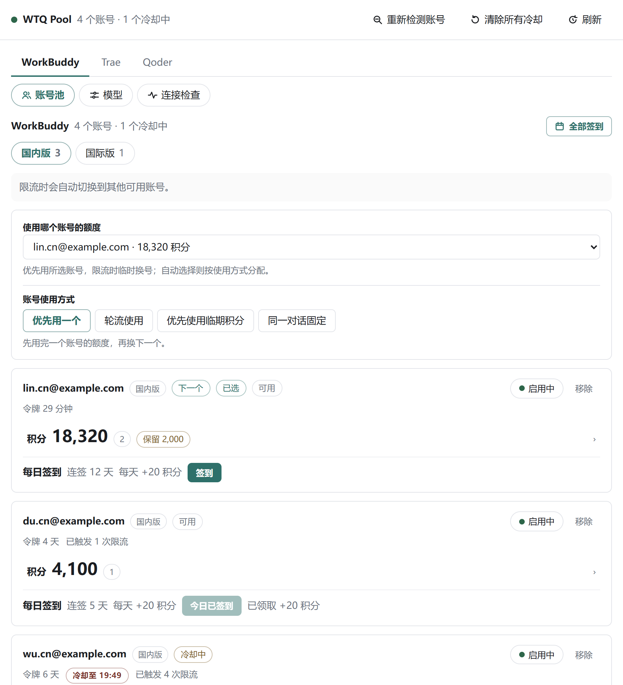
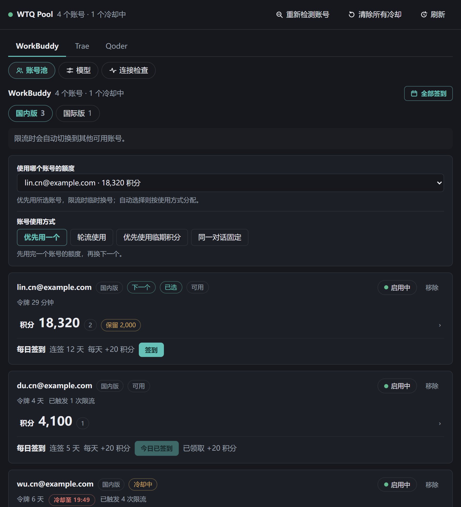
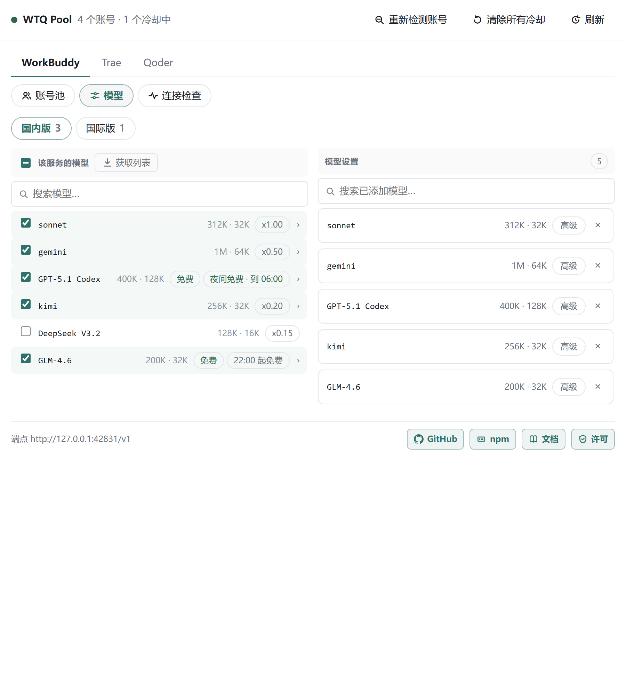
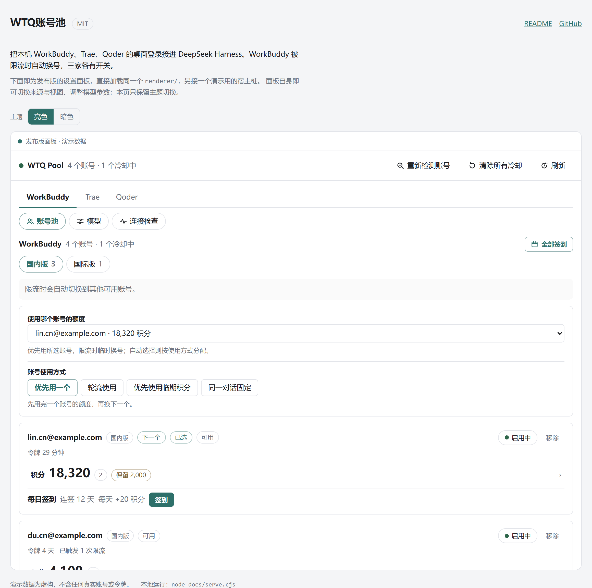
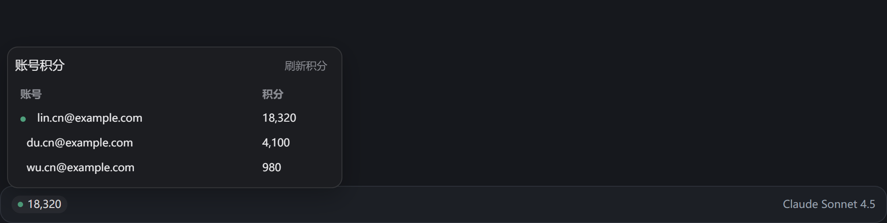

# WTQ Pool

Use local WorkBuddy, Trae and Qoder desktop sign-ins in DeepSeek Harness. WorkBuddy fails over when an account is rate-limited or out of quota; Trae and Qoder select an account per request and do not guarantee retries after failure. Each source has its own switch, with domestic and international accounts grouped separately.

[中文文档](./README.md)

## Preview

The settings panel, in its default light theme:



The panel reads DeepSeek Harness's appearance setting on load. Reload the panel after changing the host theme:



The model page edits the display name, context window, output limit, thinking levels and image support. A Trae model whose directory states a rate carries a cost tag such as `x0.79`; models that state none (and every Qoder model) stay unlabelled:



Live preview: <https://chengzhi-c.github.io/dsh-wtq-pool/>.

`docs/index.html` loads the actual panel code with synthetic demo data. It supports source switching, model settings and theme previews without reading local accounts or tokens.



With `showComposerPoints` enabled, the composer shows the current model's account credits. Click it to inspect the group and switch accounts. The image below is an off-screen render of the actual composer extension, not a conversation-test screenshot:



Run it locally: `node docs/serve.cjs`, then open the address it prints. (`docs/index.html` has to be served over http: a `file://` page cannot read the panel files beside it.)

## Features

- Reuse the local sign-ins: the plugin only reads the sign-in files the three desktop apps already saved. It starts no OAuth flow of its own and asks for no extra authorization.
- Register model groups by region: each of the three vendors' regions becomes its own provider, and they can be on at once; a region with no account is not registered.
- Account distribution: WorkBuddy supports priority, round-robin, expiring credits first and conversation-sticky accounts, with failover on rate limits or exhausted quota. Trae and Qoder support round-robin and expiring credits first.
- Credit automation: automatic check-in is off by default. The scheduled run and "Run now" perform the same round: vendor check-ins plus domestic WorkBuddy streak and task rewards and cat travel.
- Composer credits: with `showComposerPoints` on, the composer shows the balance of the account behind the current model; click it to switch accounts.
- One panel: account state, pool state, model selection and the connection check all live in the WTQ Pool card on the plugin page. The model catalog loads at startup and refreshes on demand once its cache expires; it does not poll while idle.

## Install

For a local package, run `pnpm install && pnpm run build && npm pack --pack-destination dist` in the source directory, then install the generated `.tgz`:

```powershell
$package = (Resolve-Path .\dist\dsh-wtq-pool-1.0.1.tgz).Path
dsh plugin --profile desktop add $package
```

Replace `desktop` with your actual profile name. If `dsh` is not on PATH, use the CLI in its installation directory. The npm name `dsh-wtq-pool` and the repository URL work as install sources too.

**Where the panel is**: go to **Plugins** in the sidebar and open the **dsh-wtq-pool** card (or the **Configure** control beside it); the full panel is embedded in that card. If the model groups do not appear, restart dsh as the note at the top of the panel says.

## Usage

Sign in inside each vendor's desktop app, then click "Detect accounts again". WorkBuddy reads multiple saved sign-ins; `$wbEncrypted` sign-ins from 5.6 onward use a key obtained from the local WorkBuddy installation. Domestic Trae has two sign-in slots, Trae CN and TRAE SOLO CN. Qoder keeps one sign-in per installation; signing in again overwrites the previous one.

A source is selected at the top level; below it are three screens:

- **Account pool**: each account's label, remaining credits, quota expiry, cooldown state and check-in progress. An account can be disabled on its own, or a region can be pinned to prefer one account. WorkBuddy distributes with use one first, round-robin, expiring credits first, or pin one per conversation; Trae and Qoder have round-robin and expiring credits first.
- **Models**: select which models this region exposes; anything unselected stays out of the model picker. The display name, context window, output limit, thinking levels and image support are editable. A model group publishes at most 64 models; any beyond that are marked "not published" while the gateway still serves them.
- **Connection check**: reports one line at a time whether each gateway is listening, how many models its catalog returned, whether the published address matches the one actually bound, and whether the host accepted each provider, and can copy the whole report.

Check-in runs per account, or for a whole source from the title bar. Automatic check-in is off by default; when on it claims at 09:00 (Beijing time), and a missed slot is claimed at the next start. Trae's daily check-in is once per device. Qoder's new round opens at 10:00 (Beijing time).

## Settings

| Key | Default | Meaning |
| --- | --- | --- |
| `enabled` | `true` | Off: the gateways do not start |
| `sourceWorkbuddy` / `sourceTrae` / `sourceQoder` | `true` | Off: that source is not scanned, published or requested |
| `distribution` | `priority` | How the WorkBuddy pool spreads requests: `priority` uses one first, `round-robin` spreads evenly, `expiry` spends expiring credits first, `sticky` pins one account per conversation |
| `sourceDistributions` | `{}` | Trae/Qoder distribution: `round-robin` / `expiry`; legacy `priority` is accepted |
| `cooldownSeconds` | `60` | Rate-limit cooldown. A reset time the upstream reports takes precedence; Beijing time |
| `authFile` | `""` | WorkBuddy sign-in file path; every `.info` sign-in in its directory is scanned. Empty discovers it |
| `autoCheckin` | `{"enabled":false,"hours":[9]}` | Automatic check-in switch and times; `hours` are Beijing-time hours, empty means 09:00 |
| `creditReserves` | `{}` | Per-account credit floor, keyed by account id; an account below its floor is not distributed to |
| `showComposerPoints` | `false` | Show the active account's credits in the composer |

Model selection and preferred accounts are saved by the panel. The command palette also opens the panel, detects accounts again, clears cooldowns, checks in everywhere and runs the connection check.

## Ports

```
WorkBuddy  42831 / 42841
Trae       42851 / 42861
Qoder      42871 / 42881
```

These are preferred ports. If occupied, the gateway binds an ephemeral port and runtime provider registration uses that actual address. The panel reports the fallback. Domestic models only use domestic accounts.

## Data and outbound requests

The plugin only reads local vendor sign-in files and does not modify them. Providers are registered at runtime without rewriting host provider configuration; the host still persists plugin settings in the profile. Tokens stay in the plugin process and are sent to the relevant vendor endpoints. Gateways listen on `127.0.0.1`. Panel assets and RPC require an actual loopback peer and ignore forwarded address headers, so remote browsers cannot access the panel directly. The plugin does not directly manage or delete host conversation records.

Another process on the same machine can call these loopback endpoints and spend a signed-in account's quota.

Tokens go only to the hosts below:

- WorkBuddy: `copilot.tencent.com`, `www.codebuddy.cn`, `www.codebuddy.ai`, `www.workbuddy.ai`, `www.workbuddy.cn`
- Trae: `api.trae.cn`, `solo.trae.cn`, `trae-api-cn.mchost.guru`, `coresg-normal.trae.ai`, `growsg-normal.trae.ai`
- Qoder: `gateway.qoder.com.cn`, `openapi.qoder.com.cn`, `api3.qoder.sh`, `openapi.qoder.sh`

The plugin sends no telemetry. Panel links open only when clicked.

## Development

```sh
pnpm install
pnpm run build           # emits lib/ (host half as ESM, client half as CJS)
pnpm run typecheck       # host half
pnpm run typecheck:client
pnpm test                # Node's own test runner, offline regressions
```

`src/host.ts` is the engine (account discovery, the pool, the gateways, the panel channels), `src/index.ts` is the Cordis entry (settings schema, provider registration, panel routes), `src/pi-compat.ts` adapts the host's capabilities to the calls the engine already makes, and `src/client/` is the React half: the panel and the composer readout.

## Credits

Several modules are ported from, or reference, the MIT projects below:

| Project | Copyright | Used for |
| --- | --- | --- |
| [XDTrees/dsh-workbuddy-xdpool](https://github.com/XDTrees/dsh-workbuddy-xdpool) | (c) 2026 XDTrees | WorkBuddy account pool and the port this plugin came from |
| [corrinehu/dsh-workbuddy-connect](https://github.com/corrinehu/dsh-workbuddy-connect) | (c) 2026 Corrine Hu | The loopback endpoint's security model |
| [dingminhua/dsh-connect-workbuddy](https://github.com/dingminhua/dsh-connect-workbuddy) | (c) 2026 LaoDing | Upstream API and error classification |
| [dingminhua/dsh-connect-trae](https://github.com/dingminhua/dsh-connect-trae) | (c) 2026 dingminhua | Trae protocol reference |
| [eghrhegpe/dsh-connect-qoder](https://github.com/eghrhegpe/dsh-connect-qoder) | (c) 2026 eghrhegpe | Qoder protocol reference |

## License

MIT, see [LICENSE](./LICENSE).
