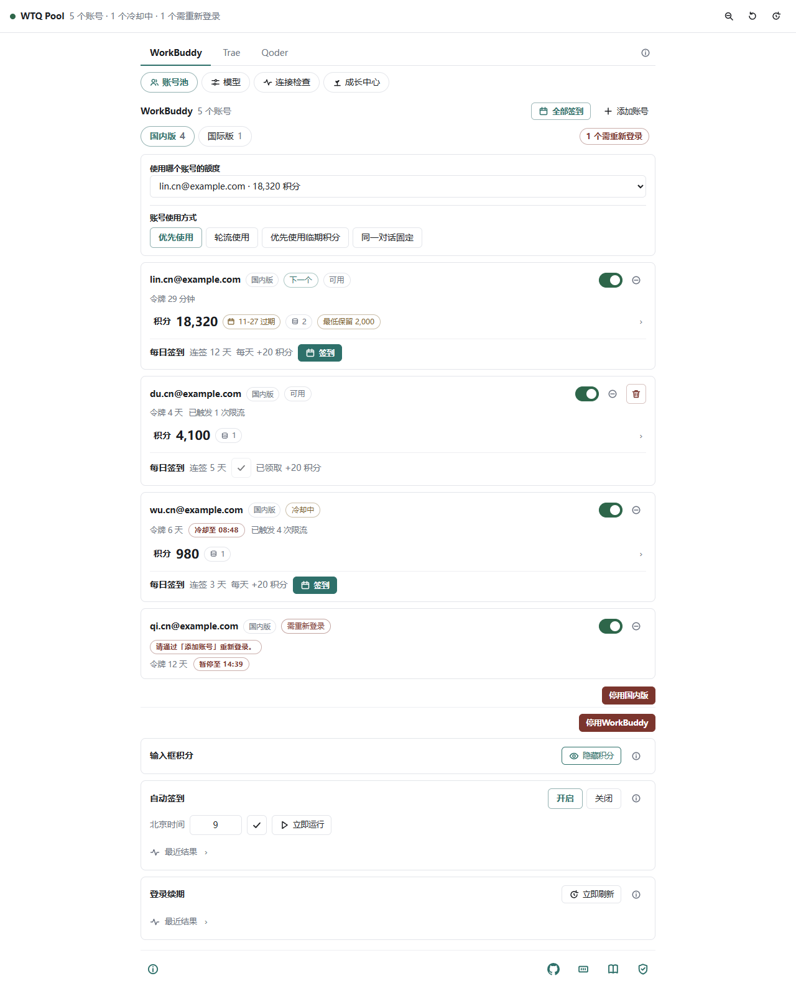
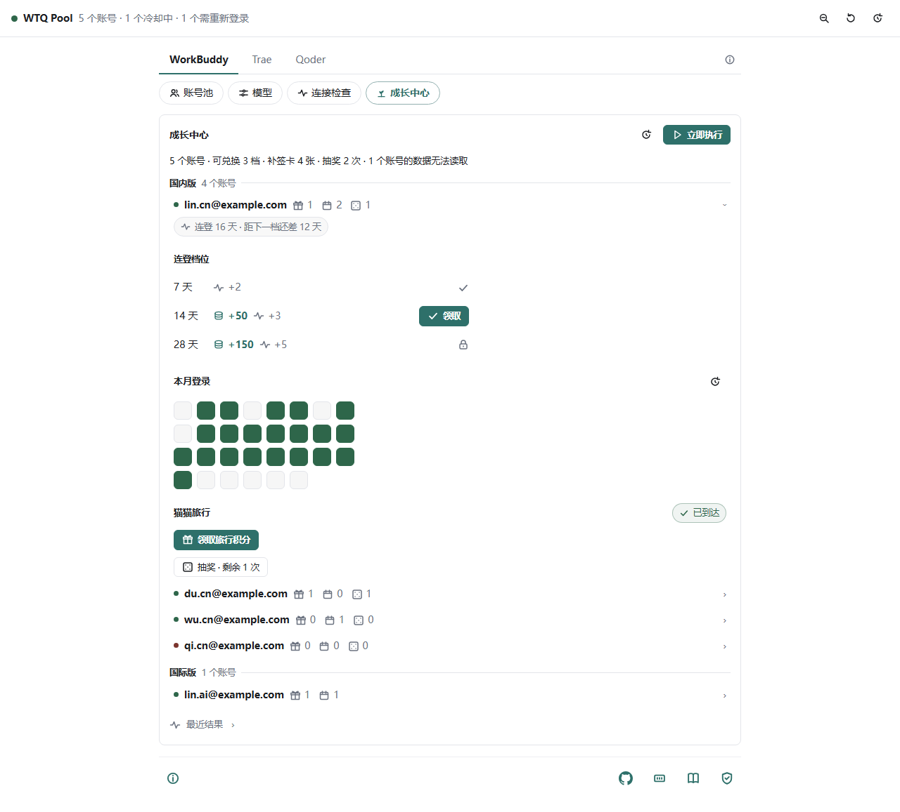

<p align="center">
  <picture>
    <source media="(prefers-color-scheme: dark)" srcset="https://github.com/chengzhi-c/dsh-wtq-pool/raw/main/docs/logo-dark.png">
    <source media="(prefers-color-scheme: light)" srcset="https://github.com/chengzhi-c/dsh-wtq-pool/raw/main/docs/logo.png">
    
  </picture>
</p>

<h1 align="center">WTQ Pool</h1>

<p align="center"><sub>DeepSeek Harness 版 · <a href="https://github.com/chengzhi-c/pi-desktop-wtq-pool">PI-Desktop 版</a></sub></p>

<p align="center"><b>在 DeepSeek Harness 中使用本机 WorkBuddy、Trae 和 Qoder 账号，并在账号不可用时自动切换。</b></p>

<p align="center">
  <a href="README.en.md">English</a> | <b>简体中文</b>
</p>

<p align="center">
  <a href="#安装">安装</a> ·
  <a href="#使用">使用</a> ·
  <a href="#功能">功能</a> ·
  <a href="#设置">设置</a> ·
  <a href="CHANGELOG.md">更新日志</a> ·
  <a href="https://github.com/chengzhi-c/dsh-wtq-pool/issues">问题反馈</a>
</p>

<p align="center">
  <a href="https://www.npmjs.com/package/dsh-wtq-pool"></a>
  <a href="https://www.npmjs.com/package/dsh-wtq-pool"></a>
  <a href="LICENSE"></a>
  <a href="https://github.com/chengzhi-c/dsh-wtq-pool/releases"></a>
  <a href="https://github.com/chengzhi-c/dsh-wtq-pool/stargazers"></a>
</p>

> 本项目仅供学习使用。非官方客户端可能触发厂商的账号风控或限制。使用前请评估风险并遵守对应服务条款。

插件按厂商和区域注册模型组。账号限流、额度耗尽或登录失效时，按对应策略切换账号。

## 安装

支持 DeepSeek Harness `0.2.0`、`0.2.2` 及 `0.2.3-alpha.2` 起的 `0.2.3` 系列（含 `engines.dsh` 允许的预发布版本），要求 Node `^22.19.0 || >=24.0.0`，并满足宿主的 Node 版本要求。

### 桌面版

在 DeepSeek Harness「插件」页选择「添加插件」→「安装第三方插件」，输入 `dsh-wtq-pool` 并安装，然后启用插件。

### 命令行

需要已安装 DSH CLI（`@deepseek-ai/dsh`）。CLI 只管理 `web`、`tui` 等非桌面 profile；`desktop` profile 由桌面应用独占，请在应用内安装。

```powershell
dsh plugin --profile web add dsh-wtq-pool
```

`web` 是 profile 名，按实际使用的 profile 替换。安装后在「插件」页打开 WTQ Pool。从 1.1.x 升级到 1.2.0 后，提供商 ID 改为 `wtqpool-*`，请重新选择模型。

## 使用

在 WorkBuddy、Trae 或 Qoder 桌面应用中登录后，在面板中点击「重新检测账号」。WorkBuddy 支持多个登录；国内 Trae 分别读取 Trae CN 与 TRAE SOLO CN。每个 Qoder 安装及 WorkBuddy 国际版各保留一个登录，登录其他账号会替换当前账号。

WorkBuddy 5.6 起的 `$wbEncrypted` 登录需要本机 WorkBuddy 的解密密钥。Windows 只使用固定本地磁盘上签名有效且公钥受支持的安装，管理员进程跳过解密；macOS 会运行本机应用读取密钥，不校验签名，macOS 和 Linux 的 root 进程跳过解密。请使用可信的 WorkBuddy 安装。

### 添加账号

通过面板的官方登录页添加账号，或导入含 `{auth, account}` 的 `.info` 文件。从源码仓库运行：

```powershell
$dshHome = if ($env:DSH_HOME) { $env:DSH_HOME } else { Join-Path $HOME ".dsh" }
$pluginData = Join-Path $dshHome "dsh-wtq-pool"
$accountFile = Read-Host "账号文件路径"
node .\tools\import-signins.cjs --data $pluginData --from $accountFile
```

可选参数：`--region cn|global|all`、`--dry-run`、`--force`。

`signins/` 含可用的访问令牌和刷新令牌，应按账号密码保护。删除插件管理的登录需要再次确认；桌面应用当前使用的登录不能从面板删除。

### 面板

「账号池」管理登录和账号状态；「模型」页设置模型组及显示选项；「连接检查」报告网关、模型目录、注册地址和宿主注册状态；「成长中心」领取 WorkBuddy 奖励。

自动签到默认关闭，时间为北京时间 09:00，可在面板修改。签到和「立即执行」可能消耗补签卡或抽奖机会。国内 Trae 每台设备每天可签到一次，Qoder 通常在北京时间 10:00 开放。

「立即刷新」仅续期签发满六小时或五分钟内到期的插件管理登录；桌面应用管理的登录由应用续期。

展开账号可查看本月登录状态：绿色表示已登录，灰色表示未登录，悬停日期可查看日期。成长中心支持领取连登档位和旅行积分、选择旅行地点、单次抽奖及补签。「立即执行」批量处理猫猫旅行和成长奖励；补签、抽奖和派遣会先确认消耗。功能可用性因地区而异。

## 功能

- 账号分配：支持优先使用、轮流使用和临期积分优先；WorkBuddy 另支持同一对话固定账号。
- 输入框积分：显示当前账号积分，点击读数后可以更换账号。
- 每个模型组最多发布 64 个模型；网关使用 SSE 流式响应，模型目录按需刷新。

### 账号切换与恢复

| 情况 | 处理方式 |
| --- | --- |
| 请求无效，或 Trae、Qoder 模型不在目录 | 返回 400 或 404，不发送对话请求 |
| WorkBuddy 限流、5xx 或主机不可达 | 尝试下一个账号；限流按上游等待时间或冷却处理 |
| WorkBuddy 额度耗尽 | 最长暂停六小时；读到正余额或手动清除冷却后恢复 |
| WorkBuddy 登录失效 | 最长暂停六小时；成功刷新令牌、重新登录或手动清除冷却后恢复 |
| WorkBuddy 套餐不支持模型（11158） | 该账号对此模型暂停 24 小时；全部账号均不支持时返回 400 |
| Trae、Qoder 登录失效、限流、额度耗尽或空响应 | 尝试下一个登录，并按冷却降低优先级；仅剩一个登录时仍会使用 |
| Trae、Qoder 上游 5xx | 返回上游错误 |

Trae、Qoder 冷却默认 60 秒，最长 24 小时。WorkBuddy 登录失效时刷新令牌并重试一次；国内版 11128 渠道校验错误仅重试一次，不暂停账号。

## 设置

插件页或 DSH 设置页可修改来源开关、WorkBuddy 分发方式、限流冷却、自动签到和输入框积分显示。完整定义与默认值见 [设置源码](https://github.com/chengzhi-c/dsh-wtq-pool/blob/main/src/index.ts)。

## 端口

| 来源 | 国内 | 国际 |
| --- | ---: | ---: |
| WorkBuddy | `42831` | `42841` |
| Trae | `42851` | `42861` |
| Qoder | `42871` | `42881` |

端口被占用时网关使用临时端口，运行时注册的模型组和面板会显示实际地址；端口在预留后、监听前被抢占时，本次不发布该模型组。PI-Desktop 版使用 `41831` 起始的独立端口范围；两版设置和凭证分开，共用 WorkBuddy 登录时刷新令牌轮换可能使另一版失效。

## 隐私与数据

插件将对话内容发送给所选厂商，不保存本地会话历史。请求同时携带所选厂商的账号与设备标识（账号 UID、机器码、设备 ID），与厂商桌面客户端一致。macOS 读取 Qoder 登录时会访问登录钥匙串，系统可能请求授权。

网关仅监听 `127.0.0.1`，但同机进程和系统用户仍可调用并消耗账号额度。登录文件和令牌归档未额外加密，依赖系统文件权限保护；Windows 下请限制插件数据目录 ACL。

数据目录为 `~/.dsh/dsh-wtq-pool/`，或 `$DSH_HOME/dsh-wtq-pool/`（设置了 `DSH_HOME` 时）。`signins/` 与 `credentials-archive.json` 含可用登录令牌，登录文件名可能含账号计费身份；归档在访问或刷新令牌中较晚的到期时间后保留 30 天，未记录到期时间的归档在删除账号时清除。

面板「删除」会清除插件管理的登录及归档，并阻止旧桌面快照重新加入；「移除」只将账号排除出分发。外部链接需点击后打开，登录页和令牌请求仅使用以下厂商主机：

- WorkBuddy：`copilot.tencent.com`、`www.codebuddy.cn`、`www.codebuddy.ai`、`www.workbuddy.ai`
- Trae：`api.trae.cn`、`solo.trae.cn`、`trae-api-cn.mchost.guru`、`coresg-normal.trae.ai`、`growsg-normal.trae.ai`
- Qoder：`gateway.qoder.com.cn`、`openapi.qoder.com.cn`、`api3.qoder.sh`、`openapi.qoder.sh`

## 预览





[在线预览](https://chengzhi-c.github.io/dsh-wtq-pool/) 使用实际面板代码和演示数据。

## 开发

```sh
pnpm install
pnpm run build
pnpm run typecheck
pnpm run typecheck:client
pnpm test
```

`src/` 保存插件逻辑，`renderer/` 保存原生 JavaScript 面板，`lib/` 为 `tsdown` 生成的发布代码。修改 `src/` 后重建 `lib/`。`typecheck` 不覆盖 `src/host.ts`；`typecheck:client` 检查客户端代码。测试使用 Node 内置测试运行器，离线执行。

## 致谢

| 项目 | 参考内容 |
| --- | --- |
| [XDTrees/dsh-xdpool](https://github.com/XDTrees/dsh-xdpool) | WorkBuddy 账号池及移植基础 |
| [corrinehu/dsh-workbuddy-connect](https://github.com/corrinehu/dsh-workbuddy-connect) | 回环端点安全模型 |
| [dingminhua/dsh-connect-workbuddy](https://github.com/dingminhua/dsh-connect-workbuddy) | WorkBuddy 接口与错误分类 |
| [dingminhua/dsh-connect-trae](https://github.com/dingminhua/dsh-connect-trae) | Trae 协议 |
| [eghrhegpe/dsh-connect-qoder](https://github.com/eghrhegpe/dsh-connect-qoder) | Qoder 协议 |
| [ardeyouxipianyi/workbuddy2api-hub](https://github.com/ardeyouxipianyi/workbuddy2api-hub) | 成长中心、多账号凭证留存与国际版活跃上报 |

随包分发的移植代码版权与许可见 [THIRD-PARTY-NOTICES.md](THIRD-PARTY-NOTICES.md)。其他项目仅列为参考。

## 许可

本项目采用 MIT 许可，见 [LICENSE](./LICENSE)。随包分发的第三方代码许可见 [THIRD-PARTY-NOTICES.md](THIRD-PARTY-NOTICES.md)。
